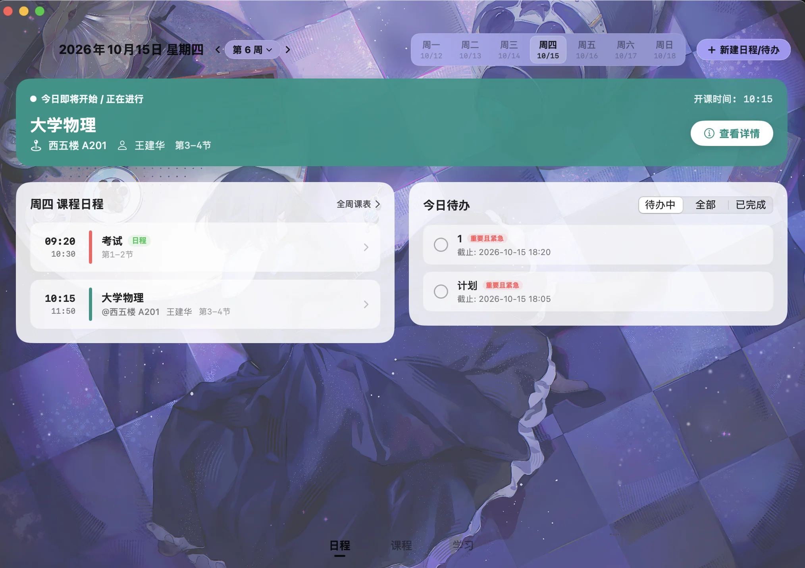

- [x] 早餐（少数几次没翘早餐的）
早起去了实验室，看了会儿论文，没看多久就不大想看了。主要是今天下雨，校园网一下雨就会变差。chatgpt 今天又爆出 model not found，外加上还在使用Antigravity 跑出一个好用的课程表，因而直接罢工了。

mac端基本上已经完成了，但小组件需要给苹果付渠道费，设计好了，也没办法处理。现在整个课程表算是集成了日历、番茄todo、wakeup课程表的核心功能。

但是，安卓端现在非常简陋，而且是pixel风味。