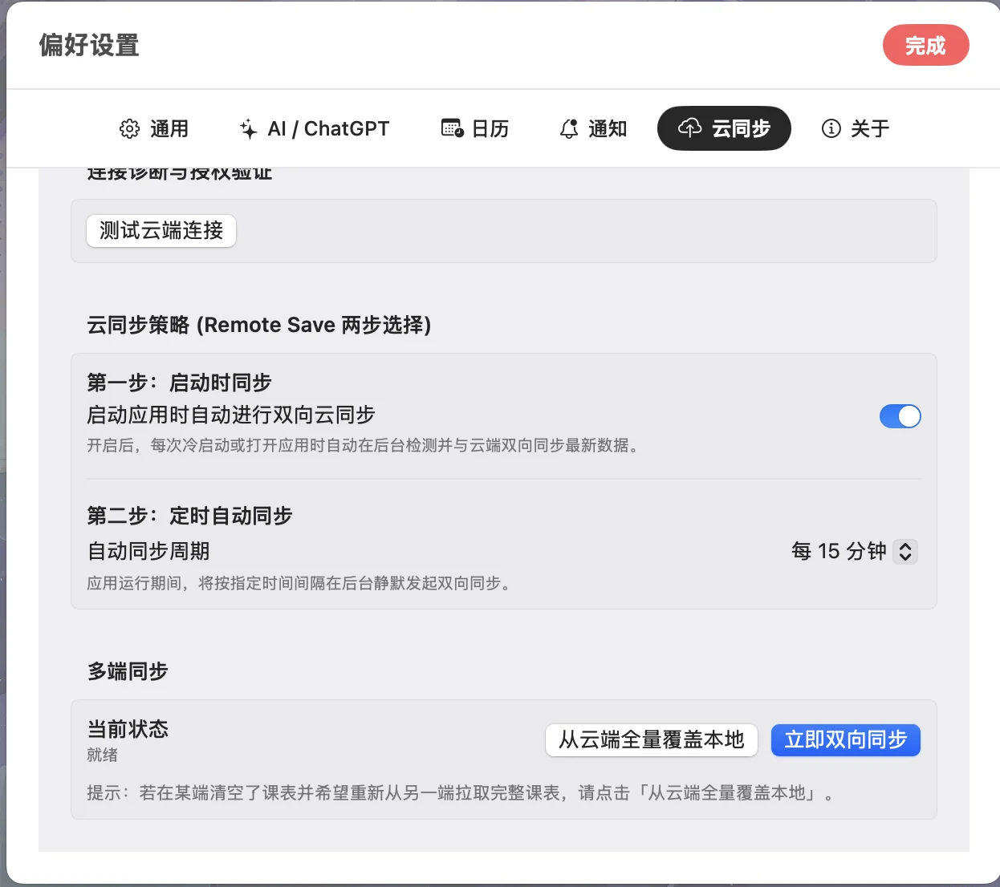

App链接 https://github.com/find-xin/ClassFlow/releases/tag/v1.0.0

经过十天左右时间，集成了wakeup的课程，苹果日历的日程，待办事项，番茄钟的classflow第一版算是最终完成了。目前发布的有Mac端和手机安卓端，其中手机安卓端有小组件，Mac端由于受到苹果渠道认证限制无法开启小组件。

Mac端本地Chatgpt客户端在载入classflow插件并创建MCP服务器后，可以让chatgpt来接管整个app。安装tunnel即可在聊天模式下使用，不消耗额度，安装classflow插件则是可以在工作模式下使用。

小米手环的还没有进行测试，仅仅只是发布，可能存在很多问题。整个app的所有数据都可以通过第三方云服务来实现多端互通。

后续开发计划（按顺序）：
1. 完善小米手环端app并测试
2. 适配安卓平板11英寸
3. 安卓端接入Chatgpt
4. 优化性能稳定性和用户体验
5. 开发Windows端（如有需求）
6. 适配ios IPhone端（如有需求）
7. 开发Linux端（如有需求）
